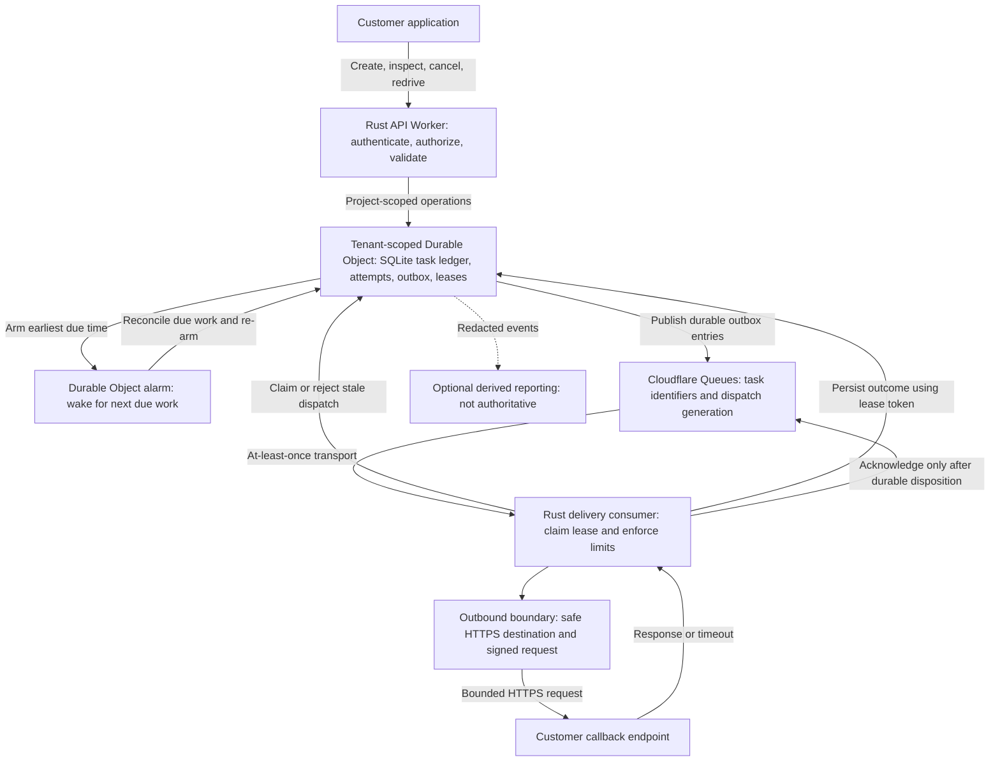
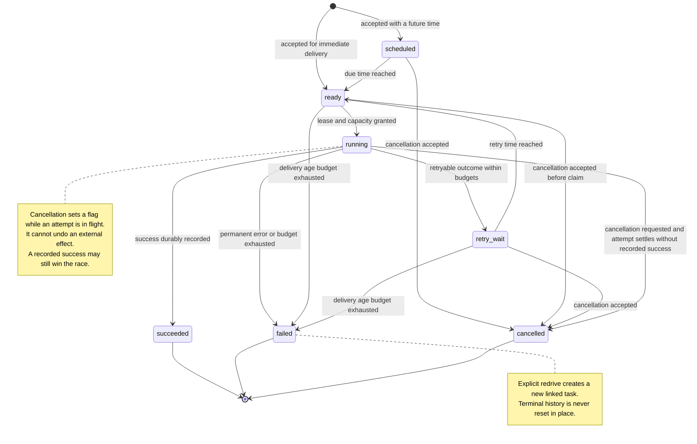

# RunLater

RunLater is a reusable HTTP task delivery API being designed around **Rust and Cloudflare**. Other systems will be able to submit work now and have RunLater deliver a signed HTTP request later, with bounded retries and a record of each attempt.

Product domain: **runlater.io**. Domain registration does not mean a hosted service is available.

## Status

**Early planning; not production-ready.** This repository currently documents the proposed product and implementation backlog. The architecture, API, and delivery semantics below are design targets, not implemented capabilities. There is no published SLA, production endpoint, or verified capacity claim.

## Planned hosts

| Host | Intended role |
| --- | --- |
| `runlater.io` | Product landing page |
| `docs.runlater.io` | Developer documentation |
| `api.runlater.io` | HTTP API |
| `www.runlater.io` | Redirect to `https://runlater.io`, preserving path and query |

This is the confirmed host layout, not a deployment claim. DNS, routes, certificates, and live service readiness still need verification before launch. See [issue #13](https://github.com/thachp/runlater/issues/13).

## Proposed MVP

- Create an immediate or one-time scheduled HTTP task.
- Read task status, list tasks, and inspect delivery attempts.
- Cancel pending work and explicitly redrive eligible terminal tasks.
- Authenticate with project-scoped API keys and enforce tenant isolation.
- Deliver signed HTTPS callbacks with bounded retries, rate limits, and concurrency controls.
- Keep auditable outcomes without logging credentials or sensitive payloads by default.

Recurring cron schedules, workflow orchestration, a full dashboard, billing, and language-specific SDKs are outside the first MVP. The versioned API contract, limits, and retention policy will be finalized in [issue #1](https://github.com/thachp/runlater/issues/1); no runnable client examples or setup commands are published yet.

## System design

The proposed source of truth is a **tenant-scoped Durable Object with SQLite storage**. Cloudflare Queues transports due work; it does not own task state or serve as long-term scheduled storage.

### Delivery path

1. **Accept durably.** Authenticate the project, validate the request and destination policy, then commit the task, create-request deduplication record, and required outbox/scheduling work before returning success.
2. **Schedule from the ledger.** Store future timestamps in SQLite. Each Durable Object has one alarm, so it wakes for the earliest due work, processes a bounded batch, and re-arms itself. Alarms can run more than once; reconciliation must be idempotent. See [Cloudflare alarms](https://developers.cloudflare.com/durable-objects/api/alarms/).
3. **Publish through an outbox.** Send identifiers and a dispatch generation, not the full customer payload, to Queues. Preserve recoverable intent across uncertain enqueue outcomes; duplicate publication is safe only because the ledger rejects stale or duplicate claims.
4. **Claim before delivery.** The consumer obtains an expiring lease with a fencing token, checks cancellation and retry budgets, and acquires tenant rate/concurrency capacity. Old messages must not trigger a newer task generation.
5. **Send and record.** Validate the outbound destination, sign the request, and enforce a timeout. Persist the result or retry decision before acknowledging the transport message. A duplicate message for already-resolved work is acknowledged without another callback.
6. **Recover.** Reconcile expired leases, stranded outbox entries, and due work after failures. An expired lease permits recovery but cannot prove that an earlier HTTP request had no effect.

Optional reporting stores are derived views, never a second authority for scheduling or state transitions. Per-tenant limits, retention, and sharding need measured capacity tests before any scale claims.

### Rust and platform validation

The intended runtime is Rust compiled to WebAssembly using [Cloudflare workers-rs](https://github.com/cloudflare/workers-rs). Before implementation, [issue #2](https://github.com/thachp/runlater/issues/2) must pin released crate/toolchain versions and prove HTTP handling, Durable Object SQLite, alarms, queue publishing/consumption, and acknowledgement behavior together. Support on an upstream main branch is not proof that the chosen release works end to end.

## Task state diagram

Proposed task states are separate from transport-message status and individual attempt records.

| State | Meaning |
| --- | --- |
| `scheduled` | Accepted durably; initial scheduled time is still in the future. |
| `ready` | Eligible for dispatch, subject to tenant capacity and cancellation checks. |
| `running` | A leased attempt is active; the destination may already have received it. |
| `retry_wait` | Waiting for the next permitted attempt after backoff. |
| `succeeded` | A successful HTTP response was recorded; this is not proof of downstream business completion. |
| `failed` | A non-retryable outcome or an exhausted delivery budget stopped further attempts. |
| `cancelled` | No further attempts will be started; a previous or in-flight request may still have had an effect. |

### Retries, cancellation, and redrive

- The ledger owns the application retry policy: bounded exponential backoff with jitter, an attempt limit, and an age limit. Timeouts and uncertain outcomes may require another attempt. HTTP status classification and bounded handling of `Retry-After` belong in the API contract.
- Transport retries recover infrastructure failures; they must not create a second independent application retry loop. Fencing prevents stale workers from overwriting newer ledger state, not from causing an already-sent external effect.
- Cancellation before an attempt is claimed prevents that attempt. While `running`, it records `cancel_requested` and suppresses future retries; it does not promise to abort the HTTP request. The attempt is allowed to settle, with success taking precedence if durably recorded. Expired leases need reconciliation and truthful uncertainty in attempt history.
- Explicit redrive of an eligible `failed` or `cancelled` task creates a **new task ID linked to the original**, with a fresh attempt budget. It never resets terminal history. Customers must understand that replay can repeat an effect whose earlier outcome was uncertain.

## Delivery contract and idempotency

The target is **at-least-once delivery attempts within configured budgets**, not guaranteed eventual success. There is no exactly-once processing, FIFO ordering, or exact-time execution promise. Cloudflare Queues itself can deliver messages more than once; see its [delivery guarantees](https://developers.cloudflare.com/queues/reference/delivery-guarantees/).

Two different forms of idempotency matter:

- **Create-request deduplication:** a project-scoped idempotency key with the same request returns the original task during a documented retention window. Reusing it with different content is a conflict. This prevents duplicate task creation, not duplicate callback effects.
- **Callback idempotency:** automatic retries carry a stable task-level identity, while each attempt has its own identity. The receiver should atomically deduplicate the business operation with its side effect. Explicit redrive has a new task identity. Supply a customer-defined business-operation key in the top-level `operation_key` field when creating the task; RunLater preserves this key across automatic retries and redrive and delivers it in the signature-covered `RunLater-Operation-Key` header. The receiver can use that stable key to deduplicate across redrives without changing the payload.

If the customer processes a callback but RunLater crashes before recording success, the callback can be sent again. Receiver-side idempotency is required even with leases, signatures, and queue deduplication.

## Security and release gates

- Authorize project ownership on every API and internal ledger operation. Store API-key hashes, support rotation/revocation, and test cross-tenant access failures.
- Require approved public HTTPS destinations. Reject local, private, link-local, metadata, and disallowed address forms, including IPv6 variants. Disable redirects by default. URL parsing alone is not an SSRF defense.
- **Prove DNS-rebinding and actual connection-target defenses in the deployed Workers runtime before enabling arbitrary destinations.** Until that evidence exists, any restricted alpha must use controlled, independently validated endpoints. An allowlist alone does not prevent DNS rebinding; runtime egress validation remains a release gate for arbitrary destinations.
- Sign callbacks with a timestamp and key identifier; document receiver verification, replay windows, and key rotation. Keep authorization credentials out of logs and URLs.
- Bound request/response sizes, header handling, timeouts, scheduling horizon, attempts, retention, and tenant resource use. Final defaults remain open decisions.
- Test failures between persistence, enqueue, claim, callback, result recording, and acknowledgement. Add duplicate-delivery, lease-expiry, cancellation-race, rate-limit, SSRF, and tenant-isolation tests before public beta.

## Implementation backlog

All items below are planned work, not completed features.

| Issue | Work |
| --- | --- |
| [#1](https://github.com/thachp/runlater/issues/1) | MVP API contract and delivery guarantees |
| [#2](https://github.com/thachp/runlater/issues/2) | Pinned Rust and Cloudflare runtime spike |
| [#3](https://github.com/thachp/runlater/issues/3) | Project authentication and tenant isolation |
| [#4](https://github.com/thachp/runlater/issues/4) | Durable ledger, deduplication, and outbox |
| [#5](https://github.com/thachp/runlater/issues/5) | Alarm-based scheduled dispatch |
| [#6](https://github.com/thachp/runlater/issues/6) | Delivery leases and crash-safe consumers |
| [#7](https://github.com/thachp/runlater/issues/7) | Destination security and callback signing |
| [#8](https://github.com/thachp/runlater/issues/8) | Retries, cancellation, and explicit redrive |
| [#9](https://github.com/thachp/runlater/issues/9) | Quotas, rate limits, and concurrency fairness |
| [#10](https://github.com/thachp/runlater/issues/10) | Attempts, audit events, and retention |
| [#11](https://github.com/thachp/runlater/issues/11) | Reliability and security release evidence |
| [#12](https://github.com/thachp/runlater/issues/12) | Onboarding and an end-to-end integration |
| [#13](https://github.com/thachp/runlater/issues/13) | Landing, docs, API hosts, and canonical www redirect |
