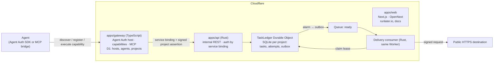

# RunLater — Target Architecture & Repo Layout

Status: **draft for review** · Companion to [PRODUCT.md](PRODUCT.md)

## Decisions

| Decision | Choice |
| --- | --- |
| Primary customer | AI agents |
| Identity | Agent Auth only (Better Auth `@better-auth/agent-auth` host). API keys, MCP OAuth, invitations, anonymous trials, receiver pairing are removed. |
| Backend | Rust (`workers-rs`) on Cloudflare Workers — task ledger, scheduling, delivery |
| Agent-facing layer | TypeScript Worker — Agent Auth host and capabilities; MCP clients reach it through the Agent Auth MCP bridge |
| Frontend | Next.js on Cloudflare Workers via OpenNext |
| Approach | Clean rebuild in a new layout; port the proven ledger/delivery core; delete milestone code. No migration of beta data. |

## System



### Responsibilities

**`apps/gateway` (TypeScript)** — the only public entry for agents.
- Agent Auth discovery, host/agent registration, capability execution (signature + `htm/htu/ath` binding checks).
- Owns identity tables in D1: `host`, `agent`, `project(host_id → project_id, trial, expiry, revoked_at)`.
- Maps each capability to one internal API call. Never accepts a project id from the caller; derives it from the authenticated host.
- MCP: no hosted `/mcp` endpoint. MCP clients run the Agent Auth bridge (`@auth/agent-cli mcp --url <gateway>`), a local stdio MCP server that holds the agent's keys and exposes generic Agent Auth tools (`connect_agent`, `list_capabilities`, `execute_capability`, …). Our capability names, descriptions and input schemas are what the agent reads through them.
- Rate limits registration and capability calls (Workers Rate Limiting binding).

**`apps/api` (Rust)** — the task authority. Not on a public route.
- Reachable only via service binding from the gateway. Every request carries a short-lived assertion `{project_id, scopes, exp}` signed with Ed25519 by the gateway; the API verifies it.
- One `TaskLedger` Durable Object per project (SQLite): tasks, attempts, idempotency keys, outbox, budget counter.
- Alarm wakes for earliest due task → writes outbox → publishes `{project_id, task_id, generation}` to Queue.
- Queue consumer claims a fenced lease, re-validates destination, signs, sends (10 s timeout), records the attempt, then acks.
- Budget is charged per attempt inside the DO, so it cannot be bypassed.
- Assertion format, scopes and the full route contract: [`packages/contracts/openapi.yaml`](../../packages/contracts/openapi.yaml).

**`apps/web` (Next.js)** — landing + docs at runlater.io / docs.runlater.io. Static-first; no auth in v1.

### Internal API (gateway → api)

```
POST   /v1/projects                    create (idempotent on host id)
GET    /v1/projects/self
POST   /v1/tasks                       schedule
GET    /v1/tasks?status=&cursor=
GET    /v1/tasks/{id}                  includes attempts
POST   /v1/tasks/{id}/cancel
POST   /v1/tasks/{id}/redrive
GET    /health
```

The OpenAPI file in `packages/contracts` is the source of truth; TS types are generated from it for the gateway.

## Repo layout

```
runlater/
├── apps/
│   ├── api/                 Rust Worker: routes, TaskLedger DO, queue consumer (thin)
│   │   ├── src/
│   │   ├── Cargo.toml
│   │   └── wrangler.jsonc
│   ├── gateway/             TS Worker: Agent Auth host, capabilities, MCP
│   │   ├── src/{index,auth,capabilities,api,projects,store}.ts
│   │   ├── migrations/      D1 SQL
│   │   └── wrangler.jsonc
│   └── web/                 Next.js + OpenNext
│       ├── app/
│       ├── content/docs/    MDX docs
│       └── wrangler.jsonc
├── crates/
│   ├── core/                Pure Rust domain: task state machine, retry policy, limits, validation. No worker deps; native unit tests.
│   └── egress/              Pure Rust: destination policy (URL/host/IP checks) + request signing
├── packages/
│   ├── contracts/           openapi.yaml, generated TS types, capability/MCP JSON schemas
│   └── tsconfig/            shared TS config
├── docs/
│   ├── spec/                PRODUCT.md, ARCHITECTURE.md (this)
│   └── adr/                 one file per significant decision
├── legacy/                  pre-rebuild code and docs, read-only until cutover (phase 7)
├── Cargo.toml               workspace: apps/api, crates/*
├── package.json             npm workspaces: apps/gateway, apps/web, packages/*
├── turbo.json               (optional) task runner
└── .github/workflows/       ci.yml, deploy.yml
```

### Environments

One `wrangler.jsonc` per app with `env.staging` and `env.production`. No per-milestone configs (`alpha/`, `beta/`, `staging/` go away). Feature flags become runtime vars, not Cargo features — the Rust build has **zero** feature flags.

### Testing

| Layer | Tool |
| --- | --- |
| `crates/*` | `cargo test` (native, fast) |
| `apps/api` | `vitest` + `@cloudflare/vitest-pool-workers` against Miniflare (DO, alarms, queues) |
| `apps/gateway` | `vitest` unit tests; `npm run test:e2e` runs the built gateway and API together in Miniflare, driven by the real `@auth/agent` SDK and the `@auth/agent-cli` MCP bridge |
| End-to-end | One script: register agent → create project → schedule → local receiver gets signed request → `get_task` shows `succeeded` |
| `apps/web` | `next build` + Playwright smoke |

Replaces the 89 files in `scripts/` and the bespoke shell harnesses.

### CI/CD

- `ci.yml`: `cargo fmt/clippy/test`, `npm run lint typecheck test`, `wrangler deploy --dry-run` per app.
- `deploy.yml`: on `main`, deploy to staging, run e2e against staging, then manual approval → production.

## What gets ported vs deleted

| Today | Fate |
| --- | --- |
| `src/core.rs`, `limits.rs`, `security.rs`, `signed.rs`, `callback.rs` (signing), `destinations.rs` / `safe_egress.rs` (policy) | **Port** into `crates/core` and `crates/egress`, cleaned up |
| `src/runtime.rs`, `publication.rs`, `transport.rs`, `delivery.rs`, `application.rs` (CQRS, outbox, leases) | **Port** the patterns into `apps/api`; one runtime instead of four |
| `production_runtime.rs`, `public_beta*.rs`, `invitation*.rs`, `anonymous_trial.rs`, `funding.rs`, `funded_tasks.rs`, `receiver_pairing.rs`, `mcp_delegation.rs`, `general_http*.rs`, `identity.rs`, `auth.rs`, `staging.rs` | **Delete** (keep in git history) |
| `agent-auth/canonical/` | **Port** into `apps/gateway` (TypeScript) |
| `agent-auth/{replacement,coordinator,prototype}` | Delete |
| `mcp/` (OAuth MCP server) | Delete; capability → tool mapping reused in gateway |
| `egress/` | Fold into `crates/egress` |
| `web/next` | Move to `apps/web`; drop `web/landing`, `web/redirect`, `web/docs`, `web/shared` |
| `alpha/`, `beta/`, `staging/`, `offline/`, `discovery/`, `examples/`, `scripts/`, `tests/` | Delete; replaced by per-app tests and one e2e |
| `docs/*.md` (40 files) | Moved to `legacy/docs/`; deleted at cutover |

## Migration plan

Each phase is one PR that leaves `main` green.

1. **Skeleton.** ✅ Create workspaces, `crates/`, `apps/`, `packages/`. Move old code under `legacy/` so nothing is lost while porting. CI runs the new layout only; legacy workflows (including the old API auto-release) are parked in `legacy/.github/workflows` and no longer run.
2. **Core crates.** ✅ Port domain + egress into `crates/core` and `crates/egress` with native tests. `crates/core` models one task as a pure state machine (generation guards stale dispatches, fence guards stale results) so phase 3 can store tasks as SQLite rows instead of the legacy whole-ledger snapshot. Phase 3 must enable `global_fetch_strictly_public` on the API Worker.
3. **API.** ✅ `apps/api`: TaskLedger DO, alarm, outbox, queue consumer, internal routes, assertion verification. The ledger's SQL runs behind a small `Db` trait, so it is tested natively against rusqlite and in workerd unchanged. `npm run test:e2e` in `apps/api` drives the built Worker in Miniflare (DO SQLite, alarms, Queues) with outbound deliveries captured locally.
   - Admission: a project may hold at most as many waiting tasks as it has attempts left, so storage is bounded by the trial.
   - The gateway's Ed25519 public key is the `GATEWAY_PUBLIC_KEY` secret. Queues `runlater-ready[-staging|-production]` must exist before the first deploy.
4. **Gateway.** ✅ `apps/gateway`: Agent Auth host (Better Auth + `@better-auth/agent-auth`) on D1, seven capabilities, Ed25519 assertions to the API, an `AuthStore` Durable Object for JWT replay and rate-limit state, and a per-IP registration rate limit.
   - The MCP bridge is validated end to end: `@auth/agent-cli@0.5.1` (SDK 0.5.1) works against the 0.6.2 server. No hosted `/mcp` endpoint is needed for it.
   - Capability calls are protected by single-use `jti` (replay returns 401) rather than the legacy request-binding check, which the standard SDK and the bridge do not send.
   - A cross-language test vector pins the assertion format: a token signed by the TypeScript gateway is verified by the Rust API's tests.
5. **Web.** Move Next.js app to `apps/web`, rewrite landing + docs from PRODUCT.md.
6. **E2E + deploy.** One e2e script, staging + production envs, deploy workflow.
7. **Cutover.** Inventory live resources, tear down old Workers (MCP OAuth, public beta API), delete `legacy/`.

## Risks

- **MCP compatibility** — Agent Auth isn't standard MCP OAuth; MCP clients need the `@auth/agent-cli` bridge, which stores agent keys on the user's machine. Validated in phase 4 (CI runs it); clients that can only use remote MCP servers are not supported.
- **Agent Auth maturity** — packages are at 0.6.x and the protocol may change. Keep it isolated in `apps/gateway/src/auth`.
- **Removing the live MCP/OAuth path** breaks any current users at cutover. Phase 7 must check for live tasks/grants first.
